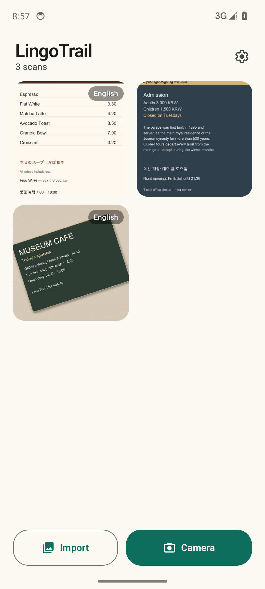
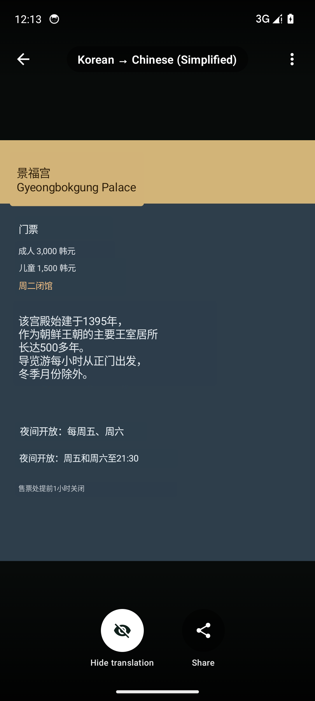
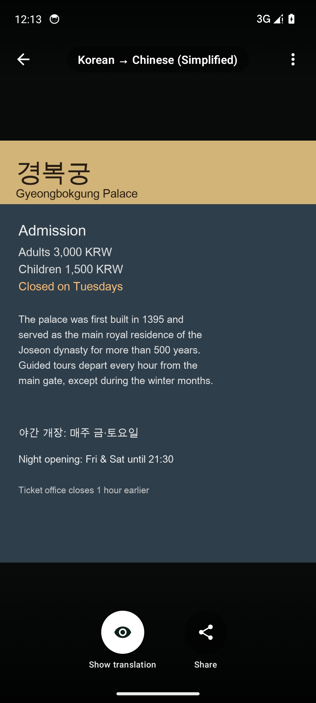
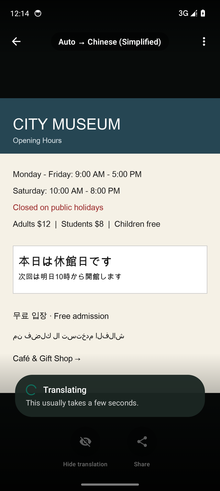
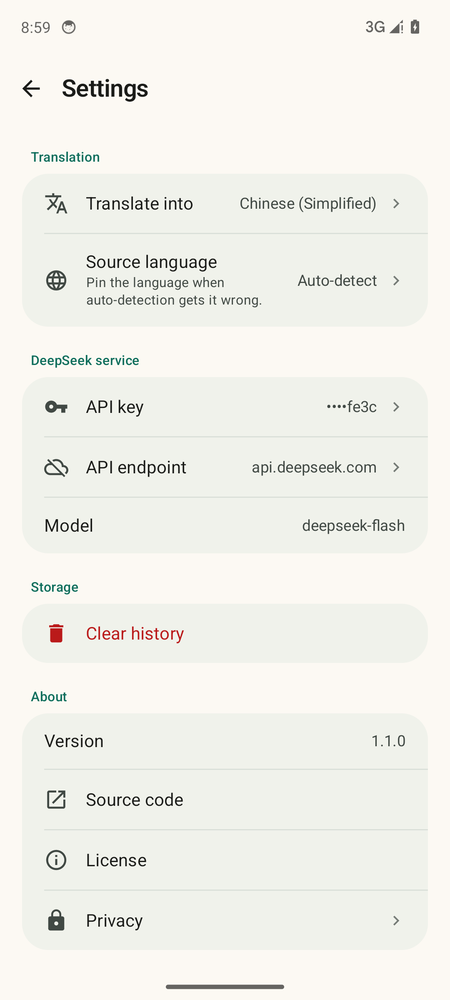
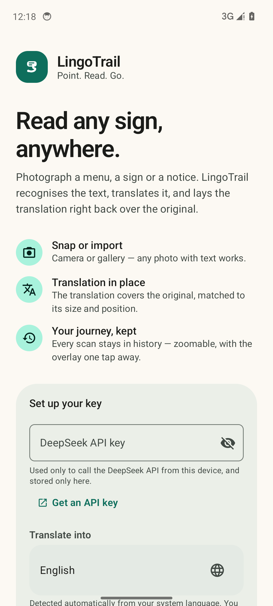

<div align="center">

# LingoTrail

**Point. Read. Go.**

Photograph any sign, menu, or notice — LingoTrail recognises the text with DeepSeek OCR,
translates it into your language, and lays the translation back over the original words.

[](https://github.com/SF-Zhou/LingoTrail/actions/workflows/ci.yml)
[](https://github.com/SF-Zhou/LingoTrail/releases/latest)
[](LICENSE)
[](https://developer.android.com)

</div>

LingoTrail is an open-source Android app for reading the world in your own language. Point the
camera at a menu, a street sign, or a museum label: the app recognises the text, translates it, and
paints the translation **in place**, matched to the original layout — no more switching back and
forth between a photo and a translation app.

It is a bring-your-own-key app. You use your own [DeepSeek](https://platform.deepseek.com) API key,
stored only on your device. There are no accounts, no analytics, and no server run by this project.

> **LingoTrail calls the DeepSeek API.** It is not affiliated with DeepSeek. API usage is billed by
> DeepSeek to your account, and DeepSeek's terms and privacy policy apply to the requests the app
> makes. Photos are uploaded to DeepSeek only when you ask for a translation, and the text is sent
> directly from your device to the endpoint you have configured.

---

## Contents

- [Screenshots](#screenshots)
- [Features](#features)
- [Install](#install)
- [Set up your DeepSeek API key](#set-up-your-deepseek-api-key)
- [How it works](#how-it-works)
- [Privacy](#privacy)
- [Build from source](#build-from-source)
- [Project structure](#project-structure)
- [Testing](#testing)
- [Releasing](#releasing)
- [Contributing](#contributing)
- [简体中文](#简体中文)
- [License](#license)

## Screenshots

| Home | Translation overlay | Original photo |
| :---: | :---: | :---: |
|  |  |  |

| Processing | Settings |
| :---: | :---: |
|  |  |

| First-run setup |
| :---: |
|  |

## Features

- **Snap or import** — take a photo with the system camera or pick any image from the gallery.
  No special camera or storage permissions are needed.
- **DeepSeek OCR with layout** — the photo is recognised by DeepSeek's OCR endpoint, which returns
  the text together with layout boxes, so lines and paragraphs keep their structure.
- **Translation you can read in place** — the recognised lines are translated into your target
  language and drawn back over the original text. The overlay samples the background colour of the
  photo and auto-fits the type to the original box. Nineteen target languages are built in,
  including English, Simplified and Traditional Chinese, Japanese, Korean, Spanish, French and
  German.
- **History that keeps every scan** — each scan stays in the app, ready to reopen, retranslate,
  delete, or clear all at once.
- **A viewer built for photos** — pinch to zoom, drag to pan, double-tap to zoom, and a single
  button to toggle the translation overlay on and off.
- **Share the result** — export a composited image with the translation drawn on it and send it
  anywhere through the Android share sheet.
- **Your key, your device** — the app uses your own DeepSeek API key. It is kept in the app's
  private storage and only sent to the API endpoint you configure.
- **English and Simplified Chinese UI** — the interface ships in both languages, and the translation
  target is detected from the system locale and can be changed at any time in Settings.

## Install

LingoTrail requires **Android 8.0 (API 26) or newer**.

1. Open the [latest release](https://github.com/SF-Zhou/LingoTrail/releases/latest) on GitHub.
2. Download `LingoTrail-<version>.apk`.
3. Optionally verify the download:

   ```bash
   # Linux
   sha256sum -c LingoTrail-1.0.0.apk.sha256
   # macOS
   shasum -a 256 -c LingoTrail-1.0.0.apk.sha256
   ```

4. Allow installing from unknown sources for your browser or file manager, then open the APK.

The app is not on the Play Store yet. Release builds use the application id
`io.github.sfzhou.lingotrail`; debug builds use `io.github.sfzhou.lingotrail.debug`, so a development
build can be installed next to a release build.

## Set up your DeepSeek API key

1. Create an API key in the [DeepSeek Platform](https://platform.deepseek.com) and make sure your
   account has credit — each scan makes one OCR request and one or more translation requests.
2. On first launch, the onboarding screen asks for the key and verifies it against the API.
3. The key is stored in the app's private storage. It is never sent anywhere except to the API
   endpoint as the `Authorization` header of requests you trigger.

You can change the key, change the target language, or point the app at a proxy/self-hosted gateway
(API endpoint override) later in **Settings**.

> **For private demo builds only:** the Gradle property `-PdefaultApiKey=sk-...` bakes a default key
> into `BuildConfig.DEFAULT_API_KEY`. Never commit an API key and never ship a published build with
> a default key — official releases are built without one.

## How it works

```
 photo ──▶ DeepSeek OCR ──▶ layout boxes ──▶ translate ──▶ overlay ──▶ history / share
          /v1/tools/ocr      grouped lines     deepseek-flash  colour + type fitting
```

1. **Capture** — a photo is taken with the system camera or imported from the gallery, decoded,
   rotated upright and stored with a thumbnail.
2. **Recognise** — the image is uploaded to `POST https://api.deepseek.com/v1/tools/ocr` with
   `purpose=rich_layout_recognition`. The response contains the recognised text and its layout
   boxes.
3. **Group & translate** — the boxes are parsed and grouped into readable lines, then translated
   into your target language in batches with the `deepseek-flash` chat model. Translations stay
   aligned one-to-one with the recognised lines.
4. **Lay it back in** — for each block the app samples the background colour around the original
   text and fits the translation into the same area, then draws the result over the photo on-device.
5. **Keep & share** — the scan and its translation are kept in history; the viewer can toggle the
   overlay and share a composited image.

Everything after the API responses is done locally on the device.

## Privacy

LingoTrail collects nothing. There are no accounts, no analytics, no advertising, and no
crash-reporting SDKs.

- Photos stay on the device until you ask for a translation. At that point the photo is uploaded
  directly from your device to the DeepSeek API endpoint configured in the app (by default
  `https://api.deepseek.com`), and the recognised text is sent for translation.
- Your API key is stored in the app's private storage and is excluded from Android auto-backup
  (`android:allowBackup="false"`).
- History and photos live in the app's private files directory. You can delete a single scan or
  clear all history in the app; uninstalling the app removes everything.

Read the full policy in [docs/privacy.md](docs/privacy.md).

## Build from source

### Prerequisites

| Requirement | Version |
| --- | --- |
| JDK | 17 |
| Android Studio | Ladybug (2024.2.1) or newer, or just the Android SDK CLI |
| Android SDK Platform | 35 (`compileSdk`/`targetSdk` 35) |
| Android SDK Build-Tools | any recent version (installed with the SDK) |
| Android Gradle Plugin | 8.7.3 (resolved by the build) |
| Gradle | 8.9 via the bundled wrapper — no local install needed |

The project uses Kotlin 2.0.21 and Jetpack Compose (Material 3).

### With Android Studio

1. Clone the repository.
2. Open the project folder in Android Studio and let it sync.
3. Select the `app` run configuration and press **Run**.

Android Studio writes the SDK location to `local.properties` (git-ignored) during sync.

### From the command line

```bash
git clone https://github.com/SF-Zhou/LingoTrail.git
cd LingoTrail

# Point at your JDK 17 and Android SDK if they are not in the default location.
export JAVA_HOME=/path/to/jdk-17
export ANDROID_HOME="$HOME/Android/Sdk"   # or ANDROID_SDK_ROOT

./gradlew assembleDebug
# APK: app/build/outputs/apk/debug/app-debug.apk

./gradlew installDebug   # with a device or emulator connected
```

If you build without Android Studio, create `local.properties` in the project root with
`sdk.dir=/path/to/Android/sdk` instead of exporting `ANDROID_HOME`.

> **Tip:** some setups keep the Android toolchain outside the default locations and provide an
> `env.sh`-style script that exports `JAVA_HOME`, `ANDROID_HOME` and `GRADLE_USER_HOME`. Source it
> before running `./gradlew` if that is how your machine is configured.

### Version overrides

The version name can be overridden without editing build files:

```bash
./gradlew assembleDebug -PversionName=1.2.3
# or
VERSION_NAME=1.2.3 ./gradlew assembleDebug
```

`versionCode` is derived from the semantic version automatically (`major * 10000 + minor * 100 +
patch`). Debug builds append a `-debug` version suffix. Release builds are minified and shrunk
(`assembleRelease`) and are signed only when release signing credentials are configured — see
[Releasing](#releasing).

## Project structure

```
LingoTrail/
├── .github/
│   ├── ISSUE_TEMPLATE/          # GitHub issue forms
│   ├── workflows/
│   │   ├── ci.yml               # tests, lint, debug APK on push/PR
│   │   └── release.yml          # signed APK + GitHub Release on v* tags
│   └── pull_request_template.md
├── app/
│   ├── build.gradle.kts         # versioning, signing, Compose, minification
│   ├── proguard-rules.pro
│   └── src/
│       ├── main/
│       │   ├── AndroidManifest.xml
│       │   ├── java/io/github/sfzhou/lingotrail/
│       │   │   ├── data/        # settings, history storage, target languages
│       │   │   ├── net/         # DeepSeek API client (OCR, translation, key check)
│       │   │   ├── ocr/         # OCR response parsing, line grouping and ordering
│       │   │   ├── overlay/     # colour sampling, text fitting, overlay rendering
│       │   │   ├── pipeline/    # OCR → translate → render orchestration
│       │   │   ├── ui/          # Compose screens, components and theme
│       │   │   └── util/        # image processing, sharing and cache helpers
│       │   └── res/             # resources; values/ (English) + values-zh-rCN/
│       ├── test/                # JVM unit tests
│       └── androidTest/         # Compose UI / instrumented tests
├── docs/
│   ├── privacy.md
│   └── screenshots/             # README screenshots
├── gradle/
│   ├── libs.versions.toml       # version catalog
│   └── wrapper/                 # Gradle 8.9 wrapper
├── scripts/
│   ├── generate-keystore.sh     # create the release signing keystore + secrets
│   └── release.sh               # local one-shot release build/publish
├── CHANGELOG.md
├── CONTRIBUTING.md
├── LICENSE
└── README.md
```

## Testing

```bash
# JVM unit tests (app/src/test)
./gradlew testDebugUnitTest

# Android Lint (fails on errors; reports in app/build/reports/lint-results-debug.html)
./gradlew lintDebug

# Instrumented end-to-end test (app/src/androidTest) — needs a device/emulator
# and a private demo key, because it calls the real DeepSeek API once per bundled photo.
# The test is skipped when no key is baked in at build time.
./gradlew connectedDebugAndroidTest -PdefaultApiKey=sk-...
```

The end-to-end test imports the three bundled photos from `app/src/androidTest/assets`, runs the
real OCR + translation pipeline, and asserts that every photo yields aligned translation blocks and
drawable overlay geometry. It is skipped automatically when `-PdefaultApiKey` is not set, so the
default CI run never needs a secret.

The CI workflow runs `testDebugUnitTest`, `lintDebug` and `assembleDebug` on every push to `main`
and every pull request, and uploads the debug APK as an artifact.

## Releasing

Releases are automated by [`.github/workflows/release.yml`](.github/workflows/release.yml). Pushing
a tag such as `v1.0.0` builds the minified release APK, signs it with the repository's release key,
verifies it with `apksigner` and `zipalign`, writes `LingoTrail-<version>.apk.sha256`, extracts the
matching section of [CHANGELOG.md](CHANGELOG.md), and publishes a GitHub Release. Tags containing a
pre-release suffix (for example `v1.1.0-rc1` or `v1.1.0-beta2`) are published as pre-releases. The
workflow can also be started manually with the **Run workflow** button and a tag name.

### One-time setup: signing key and secrets

1. Generate a release keystore (requires JDK 17):

   ```bash
   ./scripts/generate-keystore.sh
   ```

   This creates the git-ignored `signing/lingotrail-release.jks` and
   `signing/keystore.properties` with a strong random password, then prints the keystore as base64
   and the exact `gh secret set` commands. Back up both files and their passwords offline — losing
   them means you can no longer sign updates for the same app.

2. Add the four repository secrets (the script prints copy-paste commands, or use **Settings →
   Secrets and variables → Actions**):

   | Secret | Value |
   | --- | --- |
   | `ANDROID_KEYSTORE_BASE64` | base64-encoded `signing/lingotrail-release.jks` |
   | `ANDROID_KEYSTORE_PASSWORD` | keystore password |
   | `ANDROID_KEY_ALIAS` | key alias (default `lingotrail`) |
   | `ANDROID_KEY_PASSWORD` | key password |

The release workflow fails loudly if any of these secrets is missing, so a tag can never ship an
unsigned APK by accident.

### Publishing a release

1. Update `CHANGELOG.md` for the new version.
2. Commit the changes, then create and push a tag:

   ```bash
   git tag -a v1.0.0 -m "LingoTrail v1.0.0"
   git push origin v1.0.0
   ```

3. The release workflow builds, verifies and publishes the GitHub Release.

You can also build a release locally without touching CI:

```bash
# Build + verify, write dist/LingoTrail-<version>.apk and .sha256, publish nothing
./scripts/release.sh 1.0.0 --dry-run

# Build + verify + push the tag + create the GitHub Release (needs `gh auth login`)
./scripts/release.sh 1.0.0 --publish
```

`scripts/release.sh` reads `signing/keystore.properties` automatically (or the
`ANDROID_KEYSTORE_*` environment variables) and uses the same version, signing and verification
steps as CI. Run it with `--help` for details.

**Never commit** a keystore, `keystore.properties`, an API key, or anything under `signing/` or
`dist/` — they are git-ignored.

## Contributing

Contributions are welcome. Read [CONTRIBUTING.md](CONTRIBUTING.md) for the bug-report and pull
request flow, code style, and testing expectations. In short: open an issue using one of the
templates, keep pull requests focused, run the tests, and never include secrets in a report.

## 简体中文

LingoTrail 是一款开源 Android 应用：拍下或导入一张带文字的照片，应用会调用 DeepSeek OCR 识别文字并保留排版，再用 `deepseek-flash` 把识别到的语句翻译成你的目标语言，最后把译文按原位置覆盖回照片上。每一次扫描都会留在历史里；查看时支持双指缩放、拖动、双击缩放，并可一键切换译文覆盖层，也可以把合成后的译文图片分享出去。

- **自备 API Key**：需要你自己的 DeepSeek API Key，只保存在设备本机的应用私有存储中。无账号、无统计、无广告。
- **界面语言**：英文 + 简体中文；目标语言跟随系统语言，也可以在设置中修改。
- **安装**：从 [Releases](https://github.com/SF-Zhou/LingoTrail/releases/latest) 下载 APK，需要 Android 8.0（API 26）或更高版本。
- **构建**：需要 JDK 17 和 Android SDK 35，执行 `./gradlew assembleDebug`；细节见上方 *Build from source*。
- **隐私**：照片只在你主动翻译时发送到所配置的 DeepSeek API；详见 [隐私政策](docs/privacy.md)。
- **许可**：[Apache-2.0](LICENSE)，Copyright 2026 SF-Zhou。

## License

LingoTrail is licensed under the [Apache License 2.0](LICENSE). Copyright 2026 SF-Zhou.

LingoTrail is not affiliated with, endorsed by, or sponsored by DeepSeek. "DeepSeek" is a trademark
of its respective owner.
